# Panduan Penggunaan DeTim

Dokumentasi ini berisi tangkapan layar setiap fitur DeTim beserta cara menggunakannya. Semua gambar diambil dari aplikasi yang berjalan di `http://127.0.0.1:8123`.

## Daftar isi

1. Memulai dan Menambah Anggota
2. Mengatur Kelompok dan Membuat Hasil
3. Menyalin, Mengunduh, dan Mencetak
4. Riwayat dan Pengelolaan Data
5. Tampilan Mobile

## 1. Memulai dan Menambah Anggota

### Halaman awal

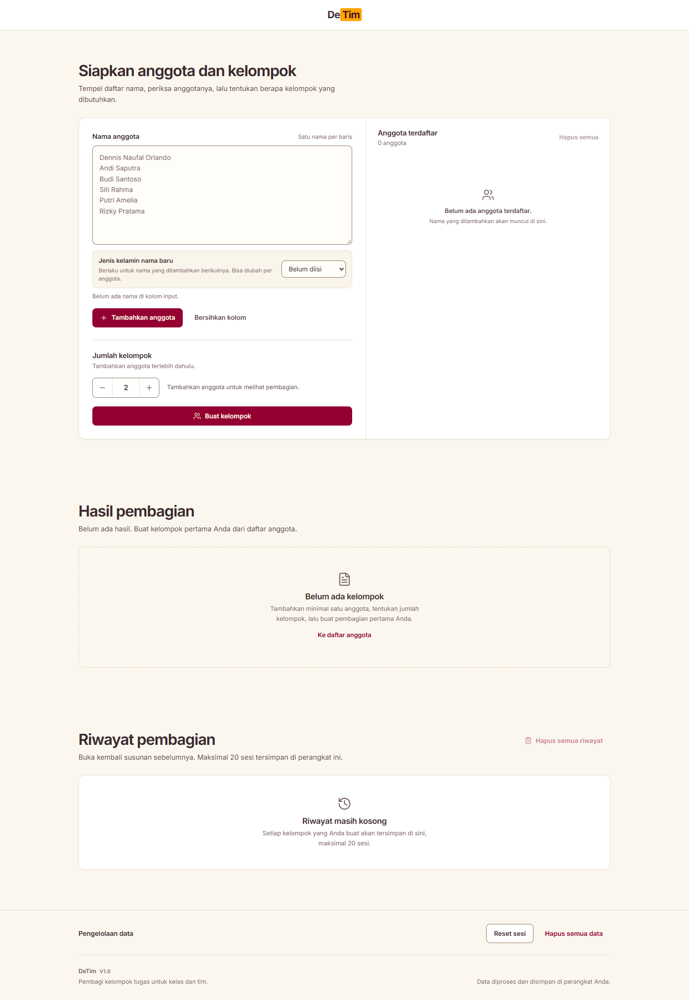

Tampilan pertama DeTim saat belum ada anggota, hasil, maupun riwayat.

**Cara menggunakan:**

1. Buka index.html atau alamat server lokal DeTim.
2. Kolom nama, pengaturan kelompok, bagian hasil, riwayat, dan pengelolaan data tersedia dalam satu halaman.
3. Data yang tersimpan di perangkat akan dipulihkan otomatis saat halaman dibuka kembali.

### Input massal dan deteksi nama ganda

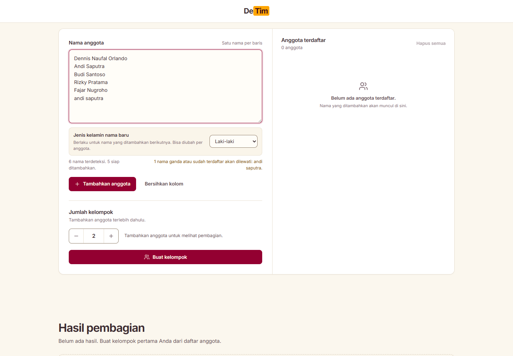

Beberapa nama dimasukkan sekaligus. DeTim mendeteksi jumlah nama, menandai duplikat, dan menyiapkan jenis kelamin untuk nama baru.

**Cara menggunakan:**

1. Ketik atau tempel satu nama per baris di kolom Nama anggota.
2. Pilih Laki-laki, Perempuan, atau Belum diisi untuk nama yang akan ditambahkan.
3. Nama ganda atau yang sudah terdaftar akan dilewati dan diberitahukan sebelum ditambahkan.

### Anggota terdaftar dengan penanda jenis kelamin

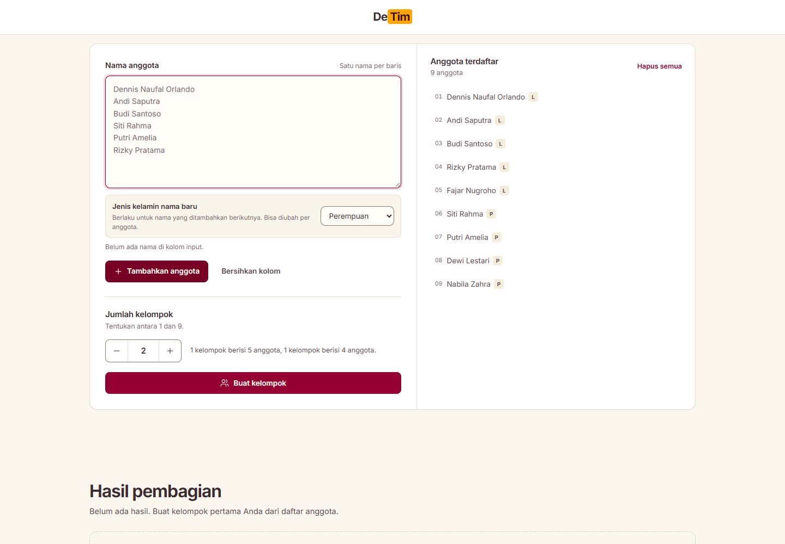

Sembilan anggota berhasil masuk ke daftar. Badge L dan P membantu memeriksa komposisi jenis kelamin.

**Cara menggunakan:**

1. Klik Tambahkan anggota untuk memindahkan nama dari kolom input ke daftar.
2. Periksa jumlah anggota dan badge jenis kelamin di panel Anggota terdaftar.
3. Gunakan tombol pensil untuk mengubah data atau tombol hapus untuk membuang anggota.

### Mengubah nama dan jenis kelamin anggota

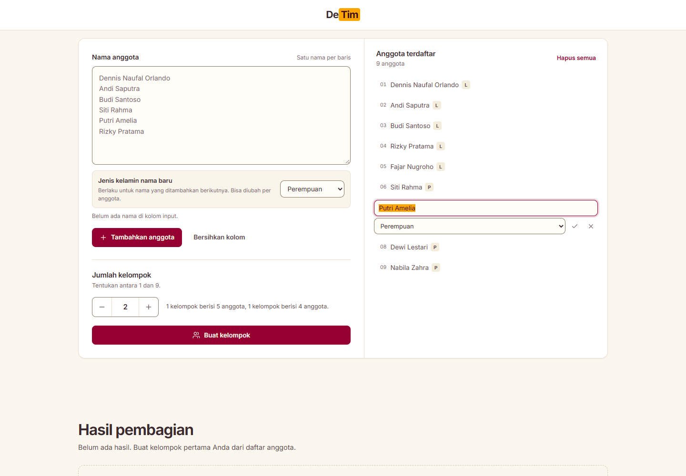

Form edit muncul langsung di baris anggota. Nama dan jenis kelamin dapat diperbaiki tanpa menghapus anggota.

**Cara menggunakan:**

1. Klik ikon pensil pada baris anggota.
2. Ubah nama, pilih jenis kelamin, lalu klik ikon centang untuk menyimpan atau ikon silang untuk membatalkan.
3. Tekan Escape untuk membatalkan perubahan dengan cepat.

### Menghapus anggota dan mengurungkannya

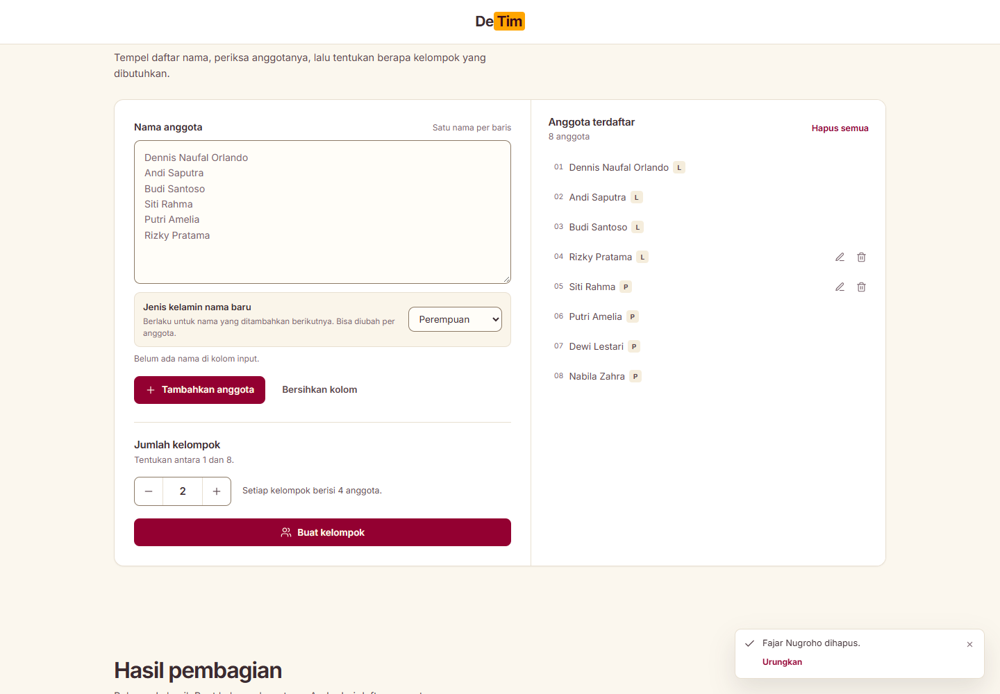

Anggota yang dihapus memunculkan notifikasi dengan tombol Urungkan selama beberapa detik.

**Cara menggunakan:**

1. Klik ikon tempat sampah pada baris anggota.
2. Jika tidak sengaja terhapus, klik Urungkan pada notifikasi untuk mengembalikannya.
3. Untuk menghapus seluruh daftar, gunakan tombol Hapus semua di panel anggota.

### Konfirmasi hapus semua anggota

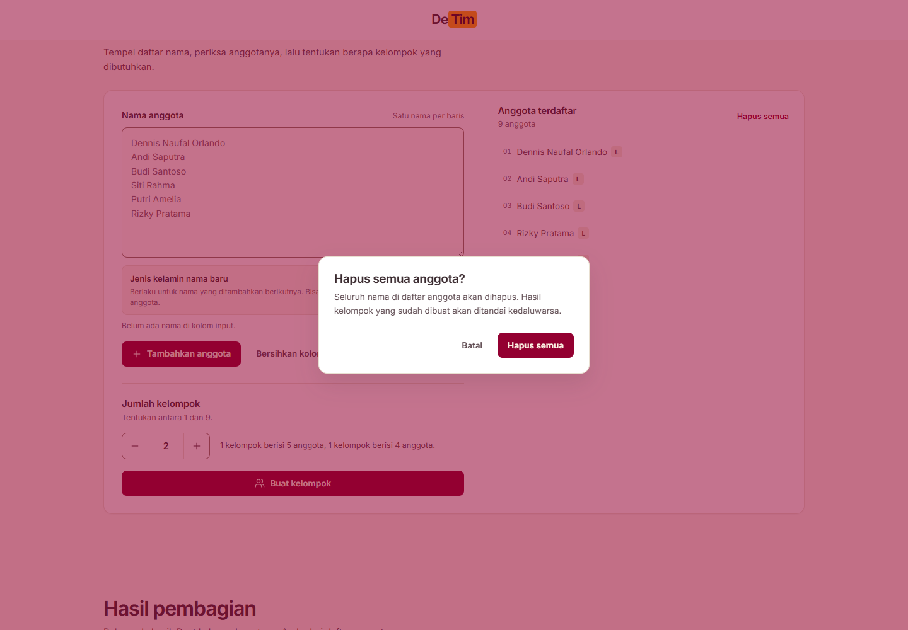

Tindakan yang berdampak besar selalu meminta konfirmasi, termasuk penghapusan seluruh anggota.

**Cara menggunakan:**

1. Klik Hapus semua di panel Anggota terdaftar.
2. Periksa pesan konfirmasi, lalu pilih Hapus semua atau Batal.

## 2. Mengatur Kelompok dan Membuat Hasil

### Menentukan jumlah kelompok

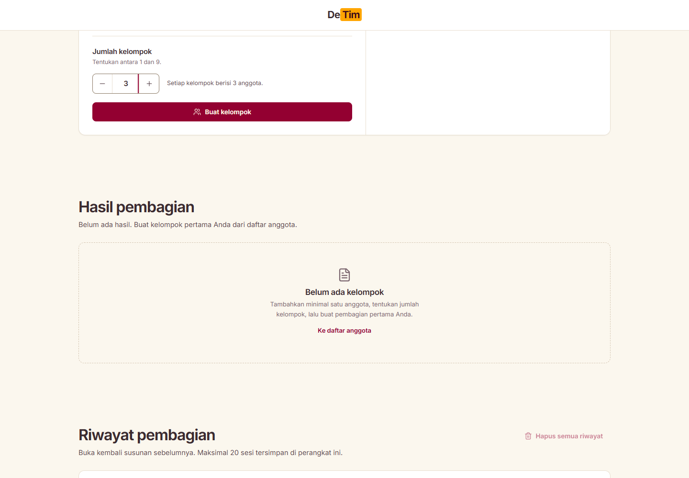

Jumlah kelompok dapat diatur lewat tombol plus/minus atau diketik langsung. DeTim menampilkan estimasi isi tiap kelompok.

**Cara menggunakan:**

1. Masukkan jumlah kelompok yang diinginkan, misalnya 3.
2. Angka harus bulat, minimal 1, dan tidak melebihi jumlah anggota.
3. Baca estimasi seperti Setiap kelompok berisi 3 anggota sebelum membuat hasil.

### Validasi jumlah kelompok

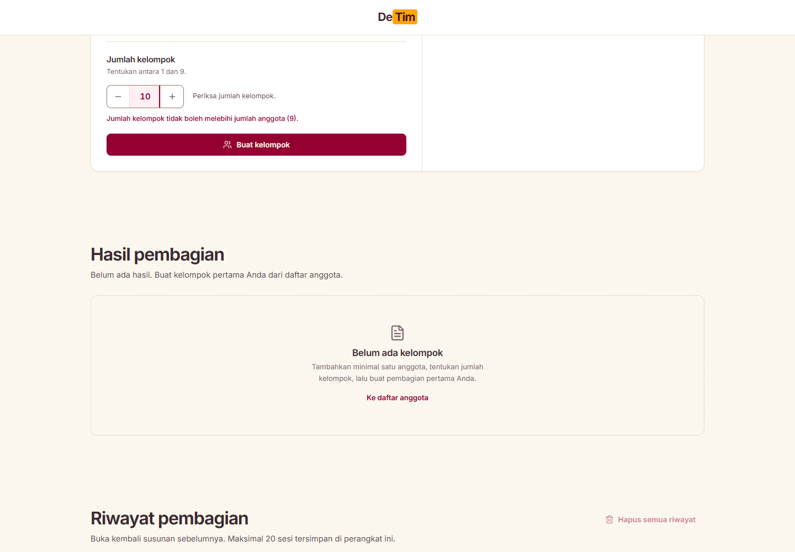

DeTim menolak jumlah kelompok yang melebihi jumlah anggota dan menampilkan pesan kesalahan yang jelas.

**Cara menggunakan:**

1. Jika jumlah kelompok tidak valid, kolom ditandai merah dan pesan muncul di bawahnya.
2. Perbaiki jumlah kelompok sebelum menekan Buat kelompok.
3. Pembagian tidak akan dijalankan sampai jumlahnya valid.

### Hasil pembagian kelompok

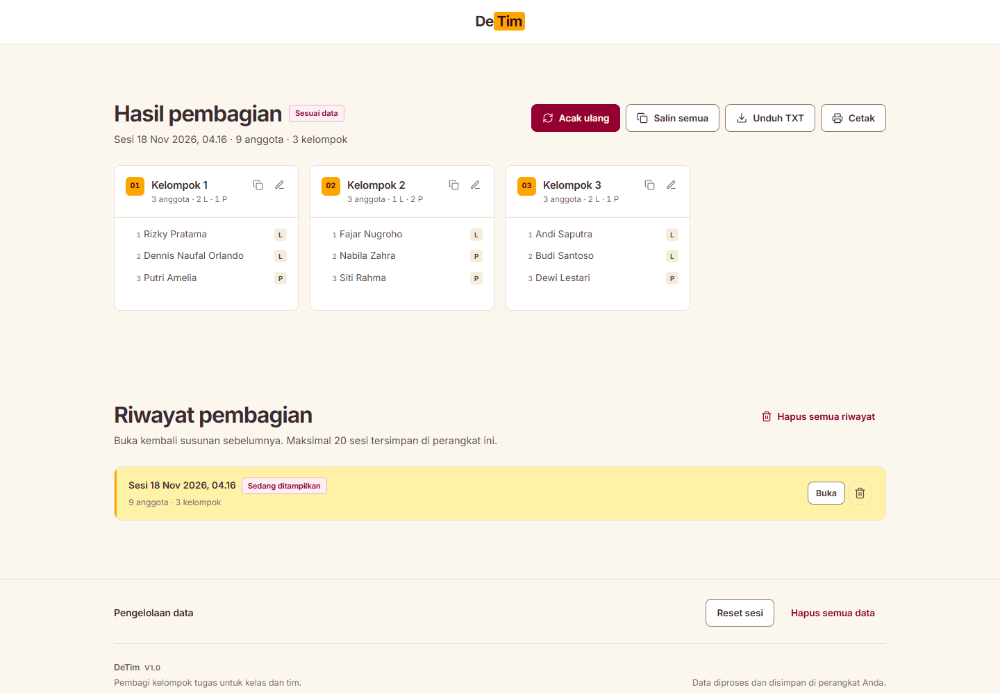

Anggota dibagi otomatis dan seimbang. Setiap kartu menampilkan nama kelompok, jumlah anggota, komposisi jenis kelamin, dan daftar nama.

**Cara menggunakan:**

1. Klik Buat kelompok setelah daftar anggota dan jumlah kelompok siap.
2. Hasil muncul sebagai kartu yang bisa disalin, dinamai ulang, atau diacak ulang.
3. Setiap anggota muncul tepat satu kali dengan selisih jumlah antar kelompok maksimal satu.

### Mengubah nama kelompok

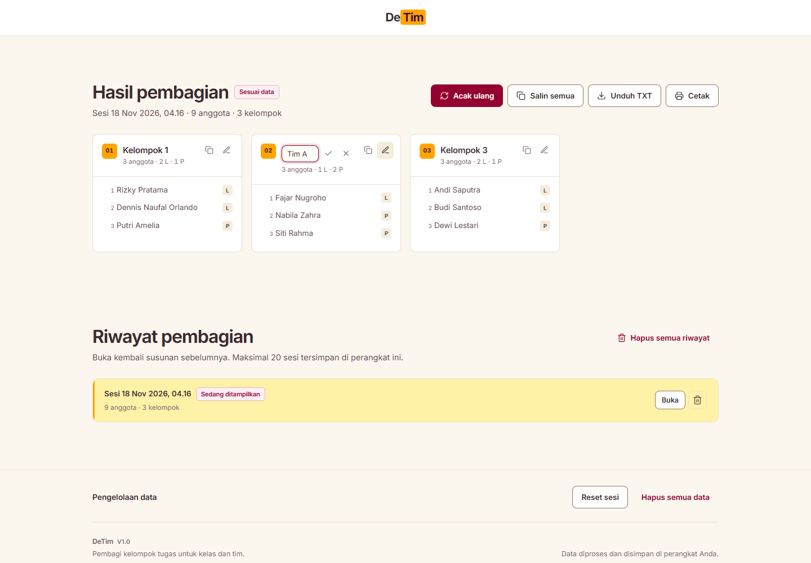

Nama kelompok dapat disesuaikan langsung dari kartu hasil, misalnya menjadi nama tim atau proyek.

**Cara menggunakan:**

1. Klik ikon pensil di kartu kelompok.
2. Ketik nama baru, lalu tekan Enter atau klik ikon centang.
3. Klik ikon silang atau tekan Escape untuk membatalkan.

### Hasil dengan nama kelompok kustom

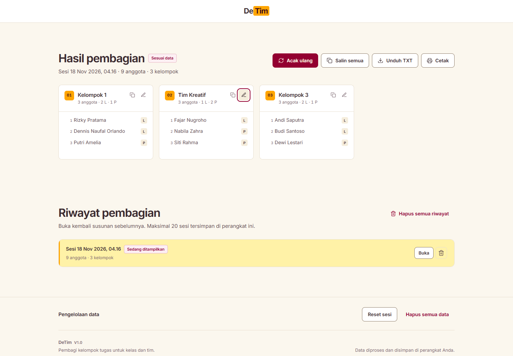

Nama kelompok baru tetap dipakai saat hasil diacak ulang dengan jumlah kelompok yang sama.

**Cara menggunakan:**

1. Setelah nama diubah, kartu hasil langsung menampilkan nama baru.
2. Nama kustom dipertahankan saat Acak ulang dipakai tanpa mengubah jumlah kelompok.
3. Nama kelompok juga ikut tersimpan di riwayat.

### Hasil ditandai kedaluwarsa

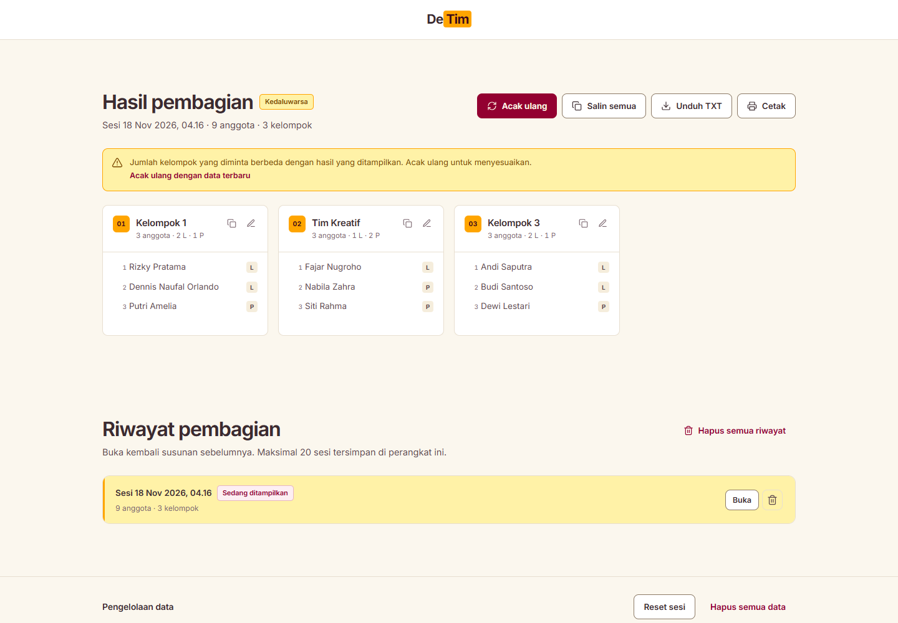

Jika daftar anggota atau jumlah kelompok berubah setelah hasil dibuat, hasil lama ditandai kedaluwarsa agar tidak dianggap terbaru.

**Cara menggunakan:**

1. Ubah jumlah kelompok atau daftar anggota setelah hasil dibuat.
2. DeTim menampilkan status Kedaluwarsa dan banner peringatan di bagian hasil.
3. Klik Acak ulang dengan data terbaru untuk membuat susunan yang sesuai.

### Acak ulang dengan data terbaru

Hasil diperbarui memakai data terbaru, status kembali Sesuai data, dan sesi aktif di riwayat ikut diperbarui.

**Cara menggunakan:**

1. Klik Acak ulang di bagian hasil untuk mendapatkan susunan baru.
2. Jika hasil kedaluwarsa, klik Acak ulang dengan data terbaru pada banner.
3. Nama kelompok kustom dipertahankan bila jumlah kelompok tidak berubah.

## 3. Menyalin, Mengunduh, dan Mencetak

### Menyalin semua hasil

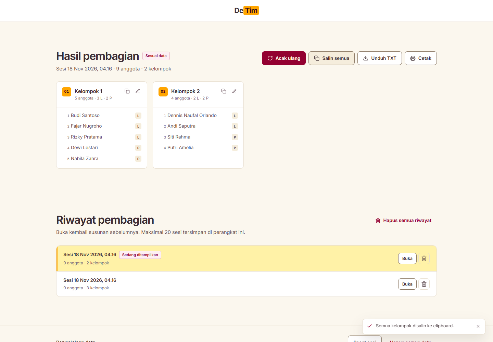

Seluruh kelompok disalin dalam format teks yang rapi, termasuk keterangan bila hasil kedaluwarsa.

**Cara menggunakan:**

1. Klik Salin semua pada bagian hasil.
2. Tempel teks ke aplikasi pesan, dokumen, atau catatan.
3. Notifikasi mengonfirmasi bahwa semua kelompok berhasil disalin.

### Menyalin satu kelompok

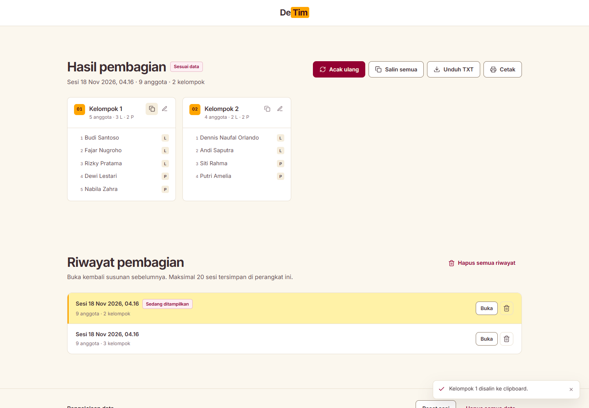

Setiap kartu memiliki tombol salin sendiri untuk mengambil daftar anggota satu kelompok saja.

**Cara menggunakan:**

1. Klik ikon salin di kartu kelompok yang diinginkan.
2. Tempel hasilnya ke pesan atau dokumen.
3. Gunakan Salin semua jika membutuhkan seluruh kelompok sekaligus.

### Mengunduh hasil sebagai TXT

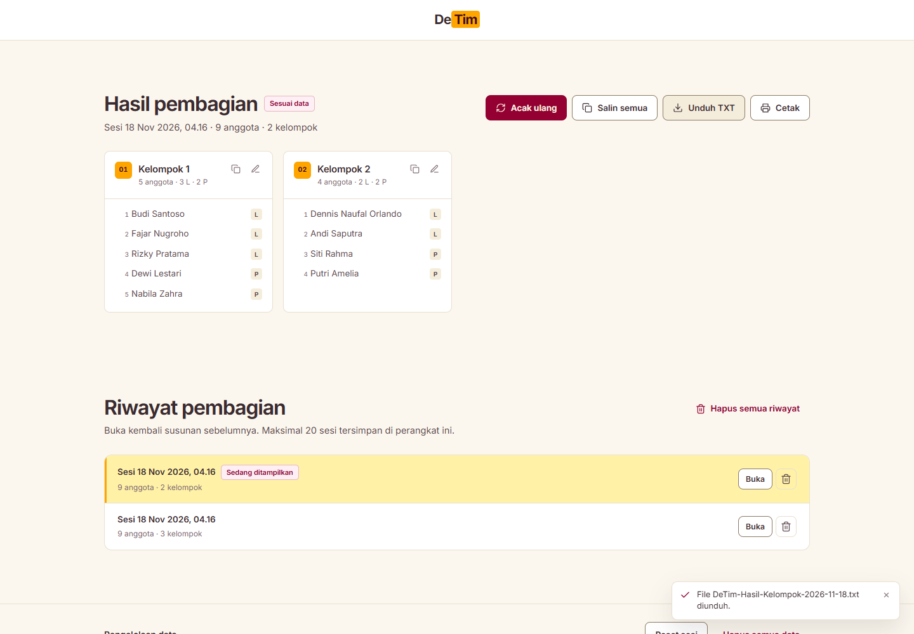

Hasil dapat diunduh sebagai berkas teks dengan nama tanggal otomatis, misalnya DeTim-Hasil-Kelompok-2026-11-17.txt.

**Cara menggunakan:**

1. Klik Unduh TXT pada bagian hasil.
2. Berkas TXT tersimpan melalui unduhan browser.
3. Berkas dapat dibuka di aplikasi teks apa pun atau dilampirkan ke pesan.

### Pratinjau cetak dan simpan PDF

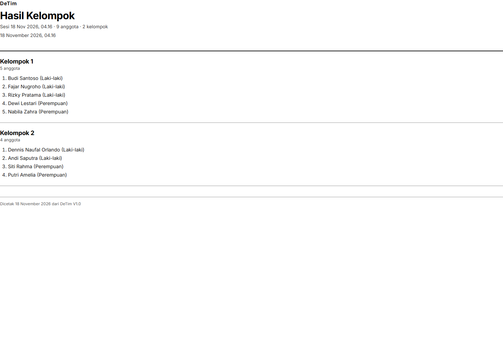

Tampilan cetak khusus berisi judul, sesi, tanggal, semua kelompok, dan anggota tanpa navigasi atau tombol aplikasi.

**Cara menggunakan:**

1. Klik Cetak pada bagian hasil.
2. Di dialog cetak browser, pilih printer atau Save as PDF.
3. Atur ukuran kertas dan margin, lalu cetak atau simpan.

## 4. Riwayat dan Pengelolaan Data

### Riwayat pembagian

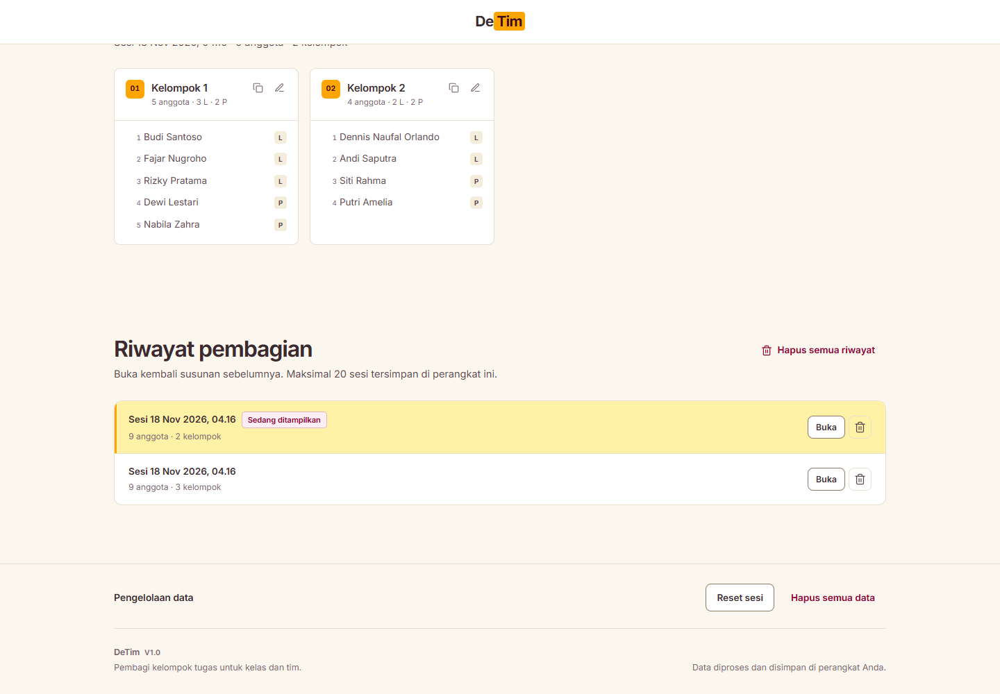

Setiap hasil baru disimpan sebagai sesi riwayat. Sesi aktif ditandai Sedang ditampilkan dan maksimal 20 sesi disimpan.

**Cara menggunakan:**

1. Buka bagian Riwayat untuk melihat sesi yang pernah dibuat.
2. Klik Buka untuk menampilkan kembali susunan lama.
3. Klik ikon tempat sampah untuk menghapus satu sesi.

### Membuka sesi dari riwayat

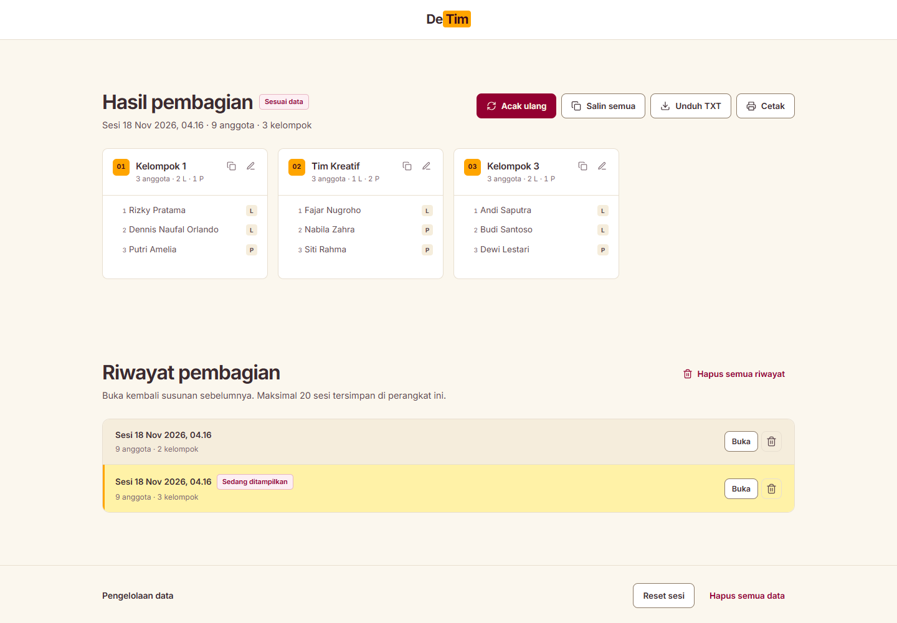

Sesi lama dapat dibuka kembali beserta anggota, jumlah kelompok, hasil, dan nama kelompok kustomnya.

**Cara menggunakan:**

1. Temukan sesi di bagian Riwayat.
2. Klik Buka pada baris sesi.
3. DeTim memuat sesi tersebut sebagai hasil aktif dan menandainya Sedang ditampilkan.

### Konfirmasi hapus satu sesi

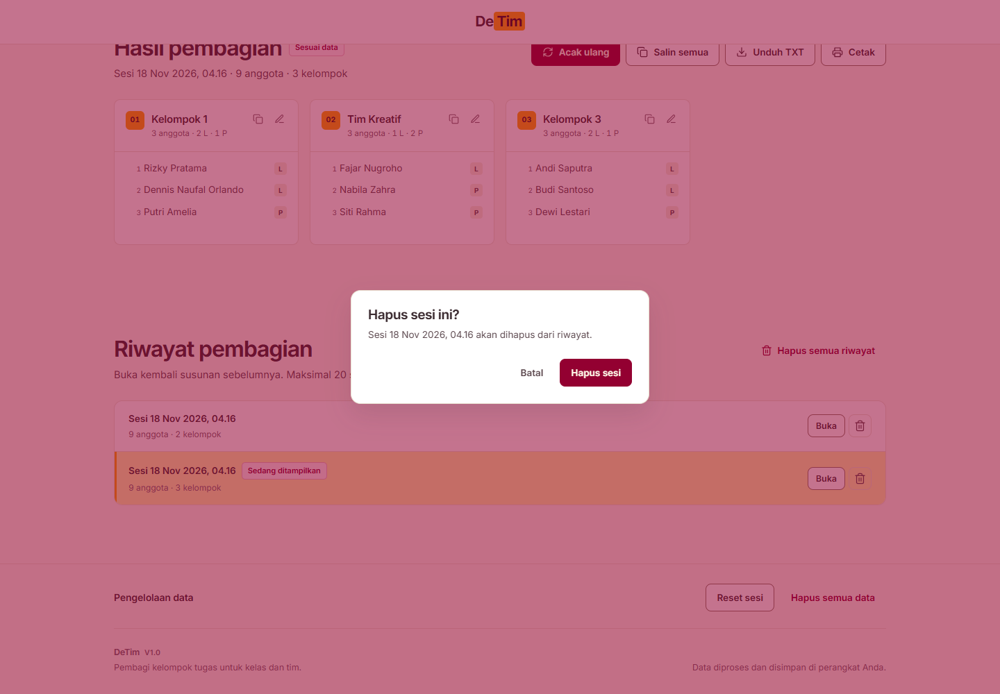

Penghapusan satu sesi riwayat juga meminta konfirmasi dan menjelaskan dampaknya bila sesi sedang ditampilkan.

**Cara menggunakan:**

1. Klik ikon tempat sampah pada baris riwayat.
2. Periksa pesan konfirmasi.
3. Klik Hapus sesi untuk melanjutkan atau Batal untuk membatalkan.

### Konfirmasi hapus semua riwayat

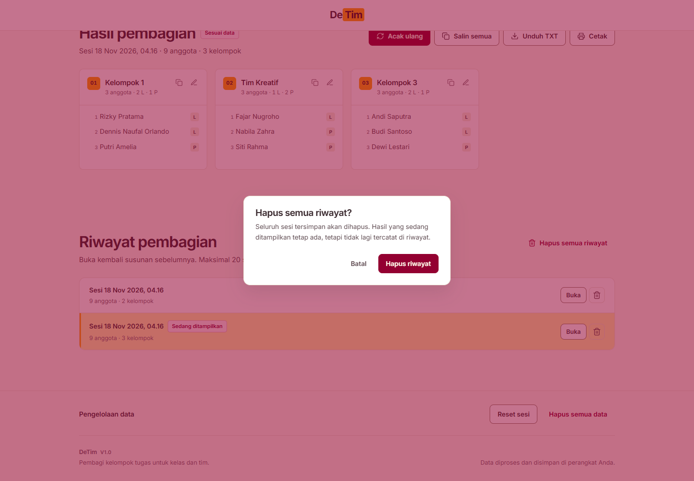

Seluruh riwayat dapat dibersihkan sekaligus. Hasil yang sedang ditampilkan tetap ada, tetapi tidak lagi tercatat.

**Cara menggunakan:**

1. Klik Hapus semua riwayat di bagian Riwayat.
2. Baca penjelasan pada dialog.
3. Klik Hapus riwayat untuk mengosongkan riwayat atau Batal untuk membatalkan.

### Pengelolaan data di footer

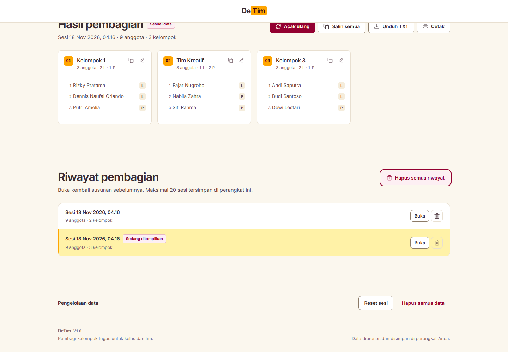

Reset sesi mengosongkan pekerjaan saat ini, sedangkan Hapus semua data menghapus anggota, hasil, riwayat, dan preferensi.

**Cara menggunakan:**

1. Gulir ke bagian Pengelolaan data di footer.
2. Pilih Reset sesi untuk memulai pekerjaan baru tanpa menghapus riwayat.
3. Pilih Hapus semua data untuk membersihkan seluruh data DeTim dari perangkat.

### Konfirmasi reset sesi

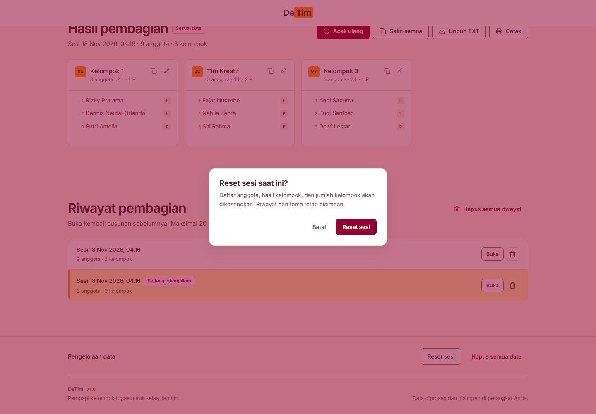

Reset sesi menghapus anggota, hasil, dan jumlah kelompok saat ini, tetapi mempertahankan riwayat dan tema.

**Cara menggunakan:**

1. Klik Reset sesi.
2. Periksa cakupan tindakan pada dialog.
3. Klik Reset sesi untuk melanjutkan atau Batal untuk membatalkan.

### Konfirmasi hapus semua data

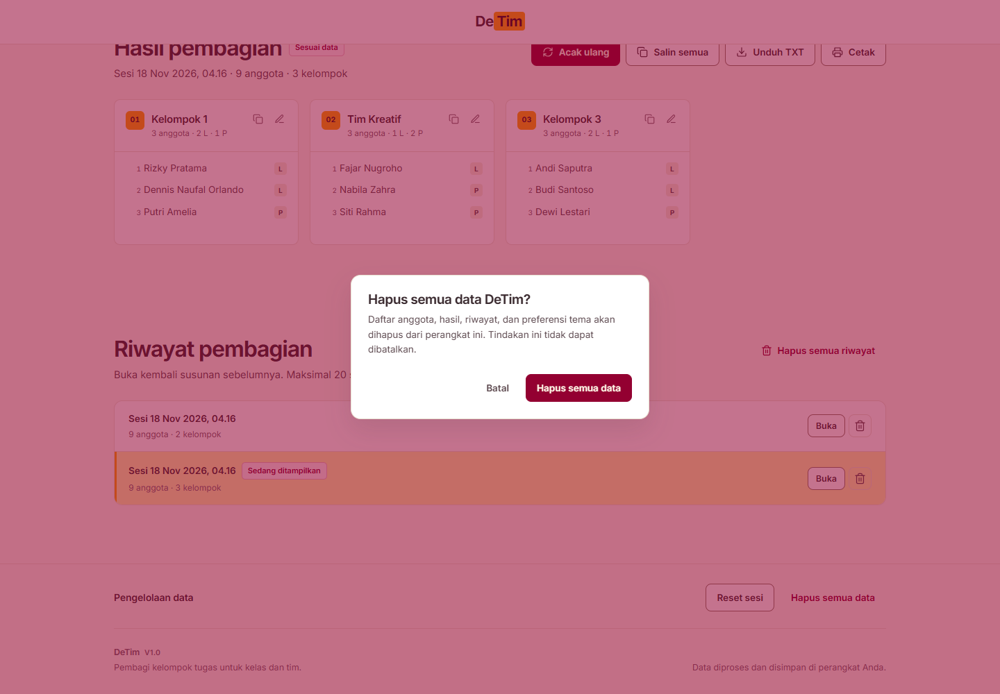

Tindakan paling menyeluruh menghapus semua data DeTim dari perangkat dan tidak dapat dibatalkan.

**Cara menggunakan:**

1. Klik Hapus semua data.
2. Baca peringatan bahwa tindakan tidak dapat dibatalkan.
3. Klik Hapus semua data untuk melanjutkan atau Batal untuk membatalkan.

## 5. Tampilan Mobile

### Formulir di layar ponsel

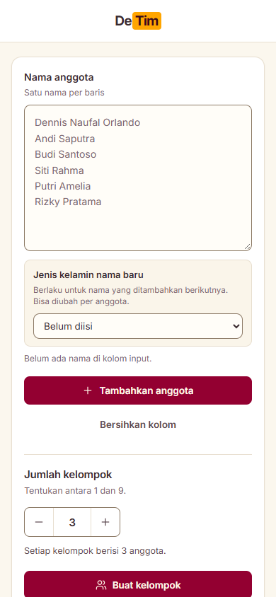

Tata letak responsif menumpuk formulir dan daftar anggota secara vertikal dengan target sentuh yang nyaman.

**Cara menggunakan:**

1. Buka DeTim di ponsel atau perkecil lebar jendela browser.
2. Kolom nama, pilihan jenis kelamin, dan tombol tersusun penuh agar mudah disentuh.
3. Gulir ke bawah untuk melihat anggota, hasil, dan riwayat.

### Hasil kelompok di layar ponsel

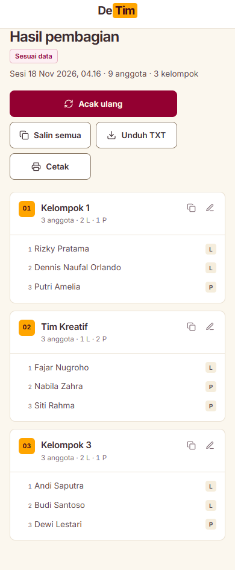

Kartu kelompok tersusun satu kolom sehingga nama anggota tetap terbaca tanpa gulir horizontal.

**Cara menggunakan:**

1. Setelah membuat kelompok, gulir ke bagian Hasil pembagian.
2. Setiap kartu kelompok tampil selebar layar.
3. Gunakan tombol salin atau pensil pada tiap kartu seperti di desktop.

---

Dibuat otomatis dari aplikasi DeTim.